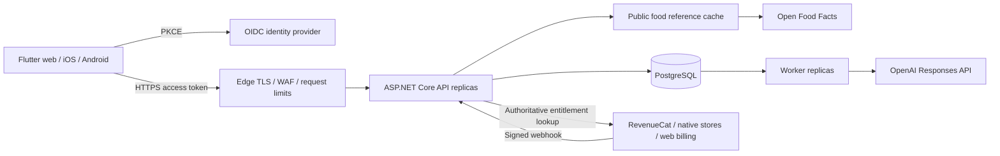

# Kaloree — Complete Mobile Handoff and Build Specification

Prepared 8 November 2026. This single document contains the mobile handoff, ready-to-use build prompt, backend behavioural contract, architecture, operations guidance, verification record and embedded OpenAPI specification.

Use this document in a separate Flutter mobile workspace. References below to companion Markdown files identify sections reproduced in this document; the OpenAPI JSON is included in the final section. Extract it as openapi.json when client-generation tooling requires a separate file. No companion attachment is required.

To start the build: provide this entire document to the mobile implementation agent and instruct it to execute the section titled Complete mobile build prompt, using every other section as reference. The backend remains in its existing dedicated workspace.

---

## Mobile handoff

# Kaloree mobile handoff

Prepared 8 November 2026. Build Flutter apps for iOS and Android in a **separate mobile repository/workspace**. This repository remains backend-only.

## Source of truth and current status

Read these files before implementing network calls:

- `openapi.json`: generated request schemas and routes.
- `api.md`: behavioural contract, versions, pagination, nutrient semantics and photo workflow.
- `architecture.md`: data flow, ownership, quotas, retention and provider boundaries.
- `operations.md`: environment configuration, identity, billing and deployment.
- `verification.md`: checks actually completed and remaining external checks.

The backend is ASP.NET Core 10 with PostgreSQL and a separate photo worker. Its recorded verification is 28 passing tests with real PostgreSQL, successful Release publish/migrations/local smoke tests, and no known vulnerable backend dependencies at audit time. **No live Railway URL, identity tenant, store products or live AI configuration has been supplied.** Do not treat a local verification as a deployed production integration.

The app calls only Kaloree's API and the selected identity/billing providers. OpenAI and nutrition-provider secret keys stay on the backend. Never call OpenAI directly from Flutter.

## Product and visual direction

Brand: **Kaloree**. Working tagline: “Snap your meal. Track your goals.” A calm, modern nutrition companion with premium glass surfaces, clear hierarchy and fast meal logging.

Suggested design tokens:

| Token | Light theme | Dark theme |
|---|---|---|
| Background | Warm ivory `#F6F7F2` | Deep forest `#101B18` |
| Primary | Forest green `#176B50` | Soft mint `#8DDFB4` |
| Main text | `#14261F` | `#F2F7F3` |
| Secondary text | `#52645B` | `#B2C4BA` |
| Accent | Apricot `#F2AD7C` | Apricot `#F2AD7C` |
| Surfaces | White/ivory, restrained translucency | Elevated forest, restrained translucency |

Validate contrast in the actual compositions; these are initial tokens, not a blanket contrast certification. Nutrient distinctions must use labels/icons as well as colour.

- Use glass primarily for the floating navigation bar, scan controls, selected summary surfaces and sheets. Use readable, more opaque surfaces for forms, charts, dense lists and destructive actions.
- Create reusable `GlassSurface`, `FloatingNavBar`, `CalorieRing`, `MacroSummary`, `MealCard`, `AsyncStateView`, `QuantityField` and `PremiumFeatureGate` components.
- Four persistent destinations: **Today, Diary, Plan, Progress**. A visually prominent central **Scan** action opens capture; it is an action, not a hidden fifth destination. Profile/settings are accessible from the top bar.
- Preserve each tab's scroll/navigation state. Respect safe areas, system gestures and Android back behaviour. Add enough bottom content padding that the floating bar never covers controls or the final list item. Hide/reposition it appropriately for keyboards and full-screen capture.
- Use a consistent spacing scale (4/8/12/16/24/32), 20–28px card radii and subtle borders/shadows. Use restrained 150–250ms transitions and haptics where appropriate; avoid constant moving gradients or nested live blurs.
- Provide light, dark and system themes. Support system text scaling, VoiceOver/TalkBack, reduced motion, increased contrast and reduced transparency. Offer an explicit opaque-surfaces setting if the platform signal is unavailable through the selected Flutter API; use a tested native bridge where needed.
- Aim for comfortable 48 logical-pixel touch targets. Support small phones, large phones, landscape where appropriate and keyboard/screen-reader navigation without clipped text.
- Prefer supportive language. No shame messaging, fabricated streaks, invented progress, or claims that a photograph measures exact calories.

Apple recommends applying glass sparingly and adapting materials to accessibility settings: [materials guidance](https://developer.apple.com/design/human-interface-guidelines/materials).

## Screens and working flows

| Area | Required behaviour |
|---|---|
| Startup | Load environment, restore secure session, route through login/onboarding, show configuration errors clearly |
| Identity | Provider signup/login, verified-email flow if configured, password recovery, logout; PKCE through the system browser |
| Onboarding | Adult date of birth, equation sex explanation, height/weight, metric/imperial presentation, activity factor, calorie/macronutrient targets, optional photo consent |
| Today | Selected local date, consumed/target calories, macro totals, meal sections, water, quick add, honest empty states |
| Diary | Date navigation, breakfast/lunch/dinner/snacks, search, custom foods, barcode scan, portion editing, manual meal entry, edit/delete |
| Scan | Just-in-time permission, camera/gallery, preview/retake, consent, compression, submit, resumable polling, review/edit, explicit save |
| Recipes | Create/edit/delete, servings, ingredient snapshots, per-serving preview and manual confirmed logging |
| Plan | Premium planned meals, future dates, edit/delete, confirmation before copying a planned meal to the actual diary |
| Progress | Weight entries, calorie/macro history from available API summaries, accessible charts and date ranges |
| Premium | Provider-loaded offerings/prices, monthly/yearly terms, restore purchases, manage subscription, pending reconciliation |
| Settings | Units/theme/accessibility, profile/goals, photo consent, privacy/terms/support, paginated export, application-data deletion |

Use loading, empty, error, retry, offline and permission-denied states on every relevant screen. Preserve unsaved forms and provide confirmation/undo where technically safe. Do not ask for camera/photos/notification permissions at startup.

## Mobile structure

Use Flutter stable with Dart null safety and feature-oriented modules. Verify package versions and native platform requirements at implementation time.

```text
lib/
  app/                 bootstrap, environments, router, app shell
  core/
    network/           API client, auth refresh, Problem Details, pagination
    security/          token vault, local encryption, redaction
    storage/           local schema, migrations, outbox, account isolation
    sync/              mutation replay, conflicts, lifecycle handling
    theme/             design tokens, accessible glass materials
    widgets/           reusable shared components
  features/
    auth/ onboarding/ dashboard/ diary/ foods/ scanning/
    recipes/ planning/ progress/ subscription/ settings/
test/
integration_test/
```

Suggested tools: Riverpod for state/dependency injection; GoRouter for routing; Dio for HTTP; generated immutable DTOs/JSON mapping; Drift or equivalent typed local storage with a verified encrypted SQLite integration; platform secure storage for credentials/DB keys; a maintained OIDC/AppAuth integration; RevenueCat's Flutter SDK; maintained camera/photo-picker/barcode packages. Do not add multiple libraries solving the same problem. Confirm plugin maintenance, permissions, license and iOS/Android compatibility.

Repository interfaces isolate API, storage, identity and billing. Widgets should not issue raw HTTP calls or contain token handling. Avoid an unnecessary general-purpose domain framework.

## Environment handoff

Provide a checked-in example configuration and separate dev/staging/production flavours. Nonsecret client configuration can use `--dart-define` or flavour config:

```text
APP_ENV
API_ORIGIN                  # e.g. https://api.example.com; append /api/v1 in one place
OIDC_ISSUER
OIDC_CLIENT_ID_IOS
OIDC_CLIENT_ID_ANDROID
OIDC_AUDIENCE
OIDC_REDIRECT_URI_IOS
OIDC_REDIRECT_URI_ANDROID
REVENUECAT_PUBLIC_IOS_KEY
REVENUECAT_PUBLIC_ANDROID_KEY
PRIVACY_POLICY_URL
TERMS_URL
SUPPORT_URL
```

These are placeholders until supplied, not working endpoints or credentials. Public SDK keys and client IDs are not server secrets. Never embed an OIDC client secret in a native public client. Release builds must reject HTTP API origins and production demo mode. Development-only cleartext exceptions must not reach release manifests.

Product owner/platform setup also needs: owned iOS bundle ID/Android application ID, Apple team/App Store Connect access, Google Play access, signing infrastructure, identity redirect registrations, RevenueCat products/entitlement mapping, legal/support URLs, and macOS/Xcode for iOS builds. Do not invent owned identifiers or upload without the required account access.

## Identity and secure lifecycle

1. Use Authorization Code + PKCE in the provider-supported system-browser session. Configure and validate redirect/deep-link handling, state and nonce through the supported SDK.
2. Use an **access token** for the configured Kaloree audience, never an ID token. Keep access tokens in memory where possible; store refresh credentials only in Keychain/Keystore-backed storage.
3. After login, explicitly `POST /api/v1/account`; retain its returned internal account ID. Fetch profile and complete onboarding if required.
4. Serialize concurrent refresh attempts; retry eligible requests once after successful refresh. Prevent refresh loops. If refresh fails, preserve permitted local drafts, stop sync and request login.
5. Scope local data, queued mutations and any billing identity to the internal account. Cancel old-account requests and ignore late responses after account switching. Clear/destroy the prior local database key and credentials on logout/deletion as defined by the privacy policy. Never replay one person's outbox under another token.
6. After explicit account deletion, do not automatically call account provisioning. Application-data deletion does not delete the identity-provider account or cancel store billing; explain and provide the appropriate separate actions.

Do not log tokens, authorization headers, photos, health/profile values or food descriptions. Redact crash reporting and analytics. Mask sensitive app-switcher previews when backgrounded where practical. Any biometric local lock is convenience access control, not a substitute for server authentication. Obfuscation is defence in depth, not a secret store. Avoid brittle certificate pinning without an operational rotation/recovery design.

## Exact backend rules

- Origin plus `/api/v1`, camelCase JSON, bearer access token. Read `api.md` for all routes. No `/auth/login`, `/auth/refresh`, chat-coach, notification-token or health-sync endpoints exist here.
- Profile has no persisted display-name/avatar/unit/theme fields. Get optional display identity from the identity provider; keep units/theme device-local unless a backend extension is agreed.
- Store/transmit metric values: kilograms and centimetres. Convert imperial values at the presentation boundary. Keep decimal precision; never convert numeric strings inconsistently by locale.
- Use `YYYY-MM-DD` **local diary calendar dates**. Do not obtain them by converting local midnight to UTC and truncating. Operational timestamps and scan quotas are UTC.
- Profile, meal, recipe and plan writes use versions. New records start at version 0; successful writes increment it. Goal updates share the profile version. Refresh profile after goal changes.
- Food and water UUIDs are immutable create keys. A changed payload with an existing UUID returns 409; create a new ID when replacing a food. Local edit UX must reflect these semantics.
- Food nutrients are per 100g; manual meal-item nutrients are totals for the submitted portion. For a known `foodId`, server-computed nutrients are authoritative. Keep a private/reference food snapshot in a draft so users can still review it offline.
- Barcode catalog responses do **not** return a persistent Kaloree `foodId`. Use returned nutrition to create a custom food with a client UUID, or build an explicit manual nutrient snapshot. Preserve source attribution. Don't use the barcode as an invented food UUID.
- Global text food search depends on a loaded catalog. An empty backend is valid; show an honest empty result plus custom-food/barcode alternatives. Don't silently substitute fake search results.
- There is no single-meal GET route or incremental change-feed. Fetch all necessary collection pages for a known date range and locate the UUID. Never assume page 1 is complete.
- Summary contains meal nutrient totals and current calorie target. Fetch water and weights separately. It does not supply historical goal changes, exercise calories, sleep, body-fat or micronutrients. Don't fabricate those metrics.
- The current backend enforces premium on photo analysis and plan create/read. Goals, recipes, tracking and export are not currently premium-gated. Do not claim security enforcement exists for a client-only product gate.
- `GET /subscription` reports premium and a nominal scan allowance; it does not expose actual remaining scans or billing usage. Its current allowance field is fixed at 100 even if server configuration differs. Don't present invented remaining-count gauges. Handle scan-limit errors precisely.
- Backend errors use Problem Details; `title` contains the stable error code and `traceId` supports troubleshooting. Branch on status/code, not arbitrary provider wording.

## Photo workflow

```text
capture/pick → preview → explicit consent → resize/strip metadata
→ POST analyses with stable Idempotency-Key → persist job ID
→ poll own job → parse resultJson → review/edit → PUT confirmed meal
```

- Supported transport: JPEG, PNG, WebP. Convert unsupported HEIC/native captures before submission. Maximum decoded image 5MiB; JSON request limit 8MiB; base64 increases payload size. Compress to a much smaller practical target without destroying detail. Correct orientation and remove EXIF/location metadata.
- Consent is required both in profile and the request body. Explain external AI processing before sending. Keep consent revocation available.
- Reuse the **same key and encoded image bytes/MIME** on a network retry. Recompression creates different bytes and needs a new intentional submission. Never create a fresh key automatically after an uncertain upload response.
- Persist the job ID and resume polling after app restart. Poll while foregrounded with bounded exponential backoff/jitter, pause in background, honour cancellation, and avoid a second scan. The backend does not push completion notifications.
- Queued/processing/completed/failed are real states. Completed `resultJson` is a JSON **string** containing `foods`, `questions`, `warning`; parse it into a separate typed model.
- Confidence is categorical low/medium/high, not a calibrated percentage. Make foods, grams and nutrients editable, and show the application's estimate warning. Ask the user to review oils/sauces/portion assumptions.
- Follow-up questions are prompts for the user to correct the draft. There is no conversational follow-up endpoint; don't imply the model processes replies automatically.
- Confirmed save is a separate `PUT /meals/{clientUuid}` with source `photo_confirmed`. Never auto-save an AI estimate. Prevent double taps and reconcile an uncertain save by UUID/version.
- Display distinct errors for consent, expired premium, monthly scan limit, global service limit, unsupported/corrupt photo and provider unavailability. Manual entry remains usable.
- Photos have no server read/download endpoint. The API deletes temporary images after processing; don't design a persistent photo gallery around nonexistent storage.

## Purchases and entitlement UX

Use RevenueCat's identified App User ID returned by account provisioning. Load offerings, actual localized prices and trial eligibility from the SDK. Never hard-code prices or universal trial claims. Use platform-supported store billing and current storefront rules; keep purchase verification on the server/provider. [Google billing guidance](https://developer.android.com/google/play/billing).

After purchase/restore, refresh `/subscription` with bounded backoff while the backend webhook reconciles. Present “Purchase received — activating premium” if entitlement has not propagated yet. A successful local purchase callback is not permission to bypass a backend 403. Handle pending/cancelled purchases, renewals, grace periods, expiration, refund and account changes. Include restore and manage-subscription actions, terms, renewal terms and privacy links. Export/deletion must remain accessible after premium expiry.

## Offline and sync

Encrypt sensitive local storage with a random per-account key held in platform secure storage. Verify actual native database encryption; don't use a plaintext fallback in production. Exclude sensitive databases, keys and photo drafts from inappropriate backups. Handle a missing/unavailable key by a safe recovery flow.

Offline support means cached diary/progress reads and queued manual edits; **AI analysis, live catalog, login and purchases require network**. Persist an outbox with operation UUID, owner, resource UUID, exact payload, expected version, dependencies and retry state. Serialize mutations per resource. Coalesce safe local edits, not unrelated writes.

- On 401: single refresh attempt, then pause queue.
- On 403: surface consent/premium state; do not repeatedly replay the blocked job.
- On 404: distinguish missing data from `account_not_provisioned`; never provision for every unrelated 404.
- On 409: refetch relevant paginated collection, compare UUID/version, and present a merge/review action when needed. No blind force overwrite. Meal/profile/recipe/plan version retries may conflict even after an earlier successful uncertain request.
- On 429: back off; distinguish fixed user/month service limits from transient throttling.
- On network/5xx: bounded retry with jitter for replay-safe operations. Preserve user drafts and show pending sync.
- Weight PUTs are day-level last-write-wins, not versioned; disclose/reconcile competing local edits instead of inventing server concurrency support.

There are no deletion tombstones/change-feed endpoints. Refresh authoritative date ranges on foreground/manual refresh; reconcile locally known IDs only after fetching complete ranges. Do not mistake absence on page 1 for deletion. A conflict-free multi-device sync engine cannot be assumed from these endpoints alone.

## Testing and release acceptance

Require `dart format`, `flutter analyze`, unit/widget tests, mobile integration tests and actual device/simulator visual review. Test dark/light, large text, reduced motion/transparency, screen readers, small screens, keyboard-safe forms and floating-nav overlap. Use image captures from rendered screens for QA; source-code review alone is insufficient for UI acceptance.

Integration scenarios: onboarding and unit conversion; manual/custom/barcode logging; pagination; offline write/restart/reconnect; version conflict; token expiry; account switch with pending requests; consent revocation; scan retry without duplicate charge; delayed scan completion; editing before confirmed save; premium propagation/restore/expiry; multi-page export; deletion without accidental reprovisioning.

Create Android release AAB and iOS archive/TestFlight preparation using the available signing infrastructure. Windows can run Android tasks; final iOS builds/signing require macOS/Xcode. Add CI with Android and macOS jobs. Validate platform permissions/deep links, privacy manifests and store disclosures against actual plugin data collection. No HealthKit/Health Connect permission is needed until those integrations exist. Local reminder functionality may be implemented on-device with opt-in settings; remote push and health sync require separately specified integrations.

Deliver source, reproducible setup, config examples, test reports, representative screenshots, release instructions and a truthful list of missing credentials/unverified steps. Store uploads and production claims require actual successful account-backed execution.


---

## Complete mobile build prompt

# Kaloree mobile build prompt

Copy the prompt below into a new chat opened in a separate Flutter mobile workspace. Attach the mobile handoff bundle, or make its files available in that workspace.

---

You are the senior Flutter engineer, mobile product designer and security engineer responsible for shipping **Kaloree**, a complete iOS and Android calorie-goal tracker with BMR/TDEE estimates and AI-assisted meal-photo logging.

Build the working application, not just a plan, static mockup or screen scaffold. Work autonomously through implementation, integration, testing and visual refinement. Use sensible defaults for reversible implementation choices. Ask only for missing information that truly blocks work; continue independent work while awaiting it. Never fabricate live credentials, endpoints, payment success, test results or release completion.

## Workspace and backend contract

This is the **mobile** workspace. The existing C# backend lives separately; do not recreate or replace it. The handoff contains `mobile-handoff.md`, `api.md`, `openapi.json`, `architecture.md`, `operations.md` and `verification.md`. Read them first and use the actual API contract as the source of truth. Inspect DTO schemas, error codes, versions and pagination before implementing network calls.

The backend uses ASP.NET Core 10/PostgreSQL and has recorded 28 passing backend tests. It is not yet confirmed deployed to Railway. A production API origin, OIDC tenant/client settings, RevenueCat public keys/products, signing identities and legal/support URLs still need configuration. Implement real adapters with explicit configuration boundaries. Development fixtures are allowed only in an explicitly labelled demo/test mode that cannot silently activate in production.

Do not invent `/auth/login`, `/auth/refresh`, incremental-sync, AI chat, push-registration, permanent meal-photo storage or health-sync endpoints. If a mobile feature needs an unavailable backend change, document the exact proposed contract in `BACKEND_REQUESTS.md`; continue with supported functionality and honest UI. Do not claim client-only controls enforce server authorization.

## Product scope

Implement complete navigation and working flows for:

1. Secure login/signup/recovery through the configured identity provider, session restoration and logout.
2. Adult onboarding: date of birth, equation sex explained separately from gender, height/weight, activity, metric/imperial display, calorie and macro targets, optional photo-processing consent.
3. Today dashboard with real selected-date calories/macros, meal sections, water and quick-add actions.
4. Date-based diary: food search, custom foods, barcode capture/lookup, portions, manual meals, edit/delete and meaningful empty/error states.
5. Photo capture/gallery → preview/retake → consent/compression → asynchronous analysis → editable review → explicit diary save.
6. Recipes with ingredients, servings, nutrient previews and confirmed portion logging.
7. Premium meal planning; planned meals become actual diary entries only through user confirmation.
8. Weight and nutrition progress charts built from available backend data, with accessible alternatives.
9. Real provider-loaded subscription offerings, localized pricing, restore/manage purchases and delayed server-entitlement activation.
10. Settings for profile/goals, units, theme, accessibility, consent, privacy/terms/support, paginated export and application-data deletion.

Preserve manual entry when AI or a provider is unavailable. Handle loading, empty, offline, error, retry, permission-denied and expired-session states. Don't invent exercise calories, historical targets, micronutrients, streaks or photos the backend doesn't supply. Optional reminder schedules can be local, opt-in device functionality; do not imply remote push exists.

## Modern visual direction

Create a polished, distinctive nutrition app centred on **glassmorphism and a floating navigation bar**, with accessibility, readability and performance taking priority in every composition.

- Warm ivory/forest-green light theme; deep-forest/mint dark theme; restrained apricot highlights. Define semantic colour, typography, spacing, radius, elevation and motion tokens centrally.
- Use frosted glass for the floating nav, scan controls, selected summary cards and sheets. Keep dense forms and long lists on readable surfaces. No blanket blur over every widget, illegible translucent text, generic dashboard clutter or gratuitous animation.
- Four persistent tabs: Today, Diary, Plan, Progress. Make Scan a prominent central action. Put profile/settings in the top bar. Preserve tab state and support Android system back and iOS navigation conventions.
- Implement reusable GlassSurface, FloatingNavBar, CalorieRing, MacroSummary, MealCard, QuantityField, AsyncStateView and PremiumFeatureGate components.
- Respect safe areas, camera cutouts, gesture regions, keyboards and bottom content padding. The floating bar must never cover actionable content. Keep one-handed frequent actions easy to reach.
- Provide coherent typography, generous spacing, clear hierarchy, comfortable touch targets, useful haptics, skeletons and subtle motion. Avoid shaming language and false precision.
- Support light/dark/system modes, large text, VoiceOver/TalkBack, reduced motion, increased contrast and opaque-surface fallbacks for reduced transparency. Where Flutter lacks a required platform accessibility signal, implement a tested bridge or explicit setting rather than claiming unsupported automatic behaviour.
- Profile on real or representative Android/iOS devices. Limit expensive backdrop filters and preserve smooth scrolling. Don't claim custom Flutter glass is automatically Apple's native Liquid Glass.

Implement the design in Flutter widgets. Use a visual-generation tool only if a raster illustration materially improves the product; core navigation, charts and surfaces should remain code-native.

## Engineering structure

Use current stable Flutter/Dart with null safety. Prefer feature-based modules and repository interfaces, Riverpod, GoRouter, Dio, immutable typed DTOs, a typed encrypted local database, platform secure storage, a maintained OIDC/AppAuth integration, RevenueCat's Flutter SDK and maintained camera/photo-picker/barcode packages. Verify currently supported versions, licenses and native requirements before choosing dependencies. Commit the lockfile.

Keep UI, application state, repositories, network transport, persistence and provider adapters separate. Widgets must not handle raw bearer tokens or issue arbitrary HTTP calls. Define dev/staging/production flavours, checked-in nonsecret config examples and reproducible setup. Native client IDs/public SDK keys are acceptable client config; provider secret keys are not.

## Authentication, privacy and security

- Authorization Code + PKCE through the provider-supported system browser, with correctly registered redirects and SDK-managed state/nonce validation. Send access tokens for the Kaloree audience, not ID tokens.
- No embedded OIDC client secret, OpenAI secret or billing server key. No WebView password collection. No production HTTP endpoints or permissive certificate validation.
- Secure refresh credentials in Keychain/Keystore-backed storage; keep access tokens in memory where practical. Serialize refresh, retry eligible calls once, and avoid infinite refresh loops.
- Explicitly provision the backend account after login. Bind all storage/outbox state and RevenueCat identification to the returned backend account ID. Never leak old-account responses or pending mutations into a new session.
- Encrypt sensitive local records with a random per-account database key in secure storage; verify actual native encryption and backup exclusions. No silent plaintext production fallback. Handle missing keys and logout/deletion safely.
- Redact logs, crash reports and analytics. Never log tokens, photo bytes, health/profile values or meal descriptions. Collect only required permissions, just in time. Strip image metadata and erase temporary capture files according to the consent flow.
- Keep export and deletion accessible regardless of premium status. Deleting application data does not cancel a store subscription or delete the identity-provider account; explain and link the separate actions. Never automatically reprovision after explicit deletion.

## Contract details that must be implemented correctly

- JSON camelCase; origin plus `/api/v1`; all private calls use bearer access tokens.
- Use kilograms/centimetres on the wire; local-calendar `YYYY-MM-DD` diary dates. Display unit conversions must not shift diary dates through UTC.
- Profile, meal, recipe and plan writes use server versions. Goals share the profile version. Food/water UUIDs are immutable create keys. Respect 409 and never blindly overwrite.
- Per-100g food nutrients differ from meal-item portion totals. Known food IDs use server-computed nutrition. Recipe snapshots cover the whole recipe; divide by servings for previews.
- Barcode catalog results lack a Kaloree food UUID: create a custom food or manual portion snapshot, preserving attribution. Handle an empty loaded catalog honestly.
- Exhaust required collection pages. No single-meal GET or incremental deletion feed exists. Do not treat a missing item on page 1 as deleted.
- Read Problem Details status/title/code and map errors to useful actions; use trace IDs for support without exposing implementation details in ordinary UI.
- Do not invent remaining photo allowances: the current subscription response does not expose real usage and its allowance field is nominal.

## AI meal scanning

Implement the full state machine, including restart/retry recovery:

capture/pick → preview → consent → correct orientation/resize/remove EXIF → submit stable bytes with Idempotency-Key → persist job ID → bounded foreground polling → parse resultJson → review/edit → explicit confirmed save.

Convert unsupported HEIC capture to a supported format. Respect 5MiB decoded/8MiB request limits and base64 overhead. Reuse the same bytes/MIME/key for uncertain upload retries. Persist job state and resume polling after restart; pause in background and back off with jitter. Prevent double submission and duplicate save.

`resultJson` is a JSON string to parse into typed food estimates/questions/warning. Confidence is categorical, not a calibrated percentage. Show editable grams, food names and nutrient totals. Ask about oils, sauces and portions. Follow-up questions help the user edit the draft; no backend chat-reply endpoint exists. Mark estimates clearly and save only after confirmation with source `photo_confirmed`. Preserve manual logging on failure.

## Billing

Identify RevenueCat using the backend's returned account UUID. Fetch actual offerings, prices and trial eligibility. Include restore, manage subscription, terms, renewal details and privacy links. Respect current platform/storefront billing requirements.

After purchase/restore, refresh backend `/subscription` with bounded retries. Handle “purchase received, activating premium” while signed backend reconciliation catches up. A local purchase callback must not bypass server premium checks. Test pending/cancelled transactions, restore, grace, refund, expiry and account switching in sandbox. Premium photo analysis and plan operations are server-enforced; do not silently change the existing free/premium boundary.

## Offline experience

Implement cached reads and a durable per-account mutation outbox for manual operations. Store operation/resource UUIDs, exact payloads, expected versions, dependencies and retry state. Serialize per-resource writes. Preserve drafts across restart.

Use bounded retry/backoff for replay-safe failures; pause on failed authentication; resolve 409 by refetching complete relevant collections and letting users review conflicts; distinguish blocked premium/consent from transient errors. Don't automatically retry monthly/global quota limits as though they were ordinary network failures. Weights are day-level last-write-wins, not versioned. AI, purchases and live catalog lookup require connectivity. Don't promise conflict-free cross-device sync when the backend does not provide that contract.

## Validation and release deliverables

Run formatting, static analysis, meaningful unit/widget tests and integration tests. Test authentication/session expiry, ownership isolation in the client cache, account switching, pagination, portion calculations, local dates/unit conversion, offline replay, version conflict, photo retries/review, subscription propagation/restore and deletion/export.

Render and inspect representative screens on Android and iOS where available. Validate light/dark, small screens, large text, screen readers, opaque glass fallback, reduced motion, keyboard layouts, nav overlap and camera permissions. Fix visual and performance defects, not just compiler errors.

Add Android/macOS CI jobs and instructions for release AAB and iOS archive/TestFlight builds. iOS building/signing requires macOS/Xcode; don't claim a Windows-only run verifies it. Configure platform permissions, deep links, privacy manifests, store disclosures, icons and splash assets. Use actual owned bundle/application IDs and signing access when supplied; do not invent production ownership.

Deliver the complete source, README, environment example, architecture notes, tests/results, representative rendered screenshots, build/release instructions, BACKEND_REQUESTS.md if needed, and a truthful list of external setup still required. No dead buttons, TODO-only core flows, silent production mocks or fabricated success states. Continue until every authorised, unblocked part of the mobile app is implemented and verified; leave blocked provider/store configuration explicit and reviewable.

Start by inspecting the workspace and reading the handoff. Establish the app structure and design system, then implement complete vertical flows until the whole supported product works. Do not stop after delivering an implementation plan.


---

## Backend API contract

# API contract

Base path: `/api/v1`. JSON uses camelCase. Send `Authorization: Bearer <access-token>` on all endpoints below. Explicitly provision an account after identity-provider login. The current OIDC issuer is the account namespace; switching issuers requires an identity migration. Configure the issuer to issue access tokens for the Kaloree audience, not ID tokens.

## Endpoints

| Method | Path | Behaviour |
|---|---|---|
| POST | `/account` | Idempotently provisions the current subject; returns internal ID / RevenueCat App User ID |
| DELETE | `/account` | Requires `X-Confirm-Delete: delete-my-account`; deletes application data |
| GET / PUT | `/profile` | Read/update profile; PUT requires current version |
| GET | `/calculations` | BMR and TDEE from completed adult profile |
| PUT | `/goals` | Calorie and macro targets; requires profile version |
| GET | `/subscription` | Verified local entitlement status |
| GET | `/foods?q=rice&page=1` | Search global and own stored foods; 30/page |
| GET | `/foods?barcode=...` | Exact stored barcode lookup |
| PUT / DELETE | `/foods/{uuid}` | Create immutable custom food / delete own food |
| GET | `/catalog/barcodes/{barcode}` | External public-reference lookup, with attribution |
| GET | `/meals?from=YYYY-MM-DD&to=YYYY-MM-DD&page=1` | Up to 31-day range; 50/page |
| PUT | `/meals/{uuid}` | Create/update whole meal snapshot using version |
| DELETE | `/meals/{uuid}?version=1` | Compare-and-delete |
| PUT / DELETE | `/weights/{YYYY-MM-DD}` | Upsert/delete weight for one date |
| GET | `/weights?from=...&to=...` | Up to 366-day range |
| PUT / DELETE | `/water/{uuid}` | Create immutable water event / delete event |
| GET | `/water?date=YYYY-MM-DD` | Water events on date |
| GET | `/summary?from=...&to=...` | Daily calorie/macronutrient totals, up to 366 days |
| GET | `/recipes?page=1` | Own recipes, 30/page |
| PUT | `/recipes/{uuid}` | Versioned recipe snapshot |
| DELETE | `/recipes/{uuid}?version=1` | Compare-and-delete |
| GET | `/plans?from=...&to=...&page=1` | Premium planned meals, up to 93-day range, 50/page |
| PUT | `/plans/{uuid}` | Premium versioned planned meal; dates within one year |
| DELETE | `/plans/{uuid}?version=1` | Delete own plan, including after premium expiry |
| POST | `/analyses` | Premium, explicit consent, mandatory `Idempotency-Key`; returns 202 |
| GET / DELETE | `/analyses/{uuid}` | Poll/delete own photo-analysis job |
| GET | `/export?page=1` | Each collection capped at 500 records/page; continue until all arrays empty |

`/health/live` and `/health/ready` are anonymous. `/webhooks/revenuecat` uses provider HMAC authentication, not user tokens. OpenAPI is generated at `/openapi/v1.json` only in Development. The worker role exposes only health routes.

## Profile and goals

```json
{
  "birthDate": "1995-03-20", "equationSex": "female", "heightCm": 170,
  "weightKg": 70, "activityFactor": 1.375, "photoConsent": true, "version": 0
}
```

Equation sex selects the equation constant; it is not a gender-identity field. Supported activity factors: 1.2, 1.375, 1.55, 1.725, 1.9. The initial product supports adults 18–100, height 100–250cm and weight 30–400kg. These application bounds are not clinical suitability determinations.

```json
{ "calories": 2100, "proteinPercent": 25, "fatPercent": 30, "version": 1 }
```

The remainder is carbohydrate. Calorie targets are manually selected (1200–6000). The backend does not automatically prescribe a calorie deficit, infer pregnancy, or treat medical conditions.

## Meal write

```json
{
  "date": "2026-11-08", "slot": "lunch", "name": "Chicken and rice",
  "source": "manual", "version": 0,
  "items": [
    { "foodId": null, "name": "Cooked rice", "grams": 150,
      "calories": 195, "protein": 4, "carbs": 42, "fat": 0.5 }
  ]
}
```

Slots: breakfast/lunch/dinner/snack. Sources: manual/photo_confirmed/recipe/barcode. Items: 1–50. If `foodId` is supplied, the backend computes nutrient totals from that accessible food and grams, ignoring caller-supplied nutrient totals. If absent, supplied totals represent the entire item portion, not values per 100g.

For `PUT /foods/{uuid}`, send `name`, optional `barcode`, `calories100g`, `protein100g`, `carbs100g`, `fat100g`. Food IDs and water-event IDs are immutable create keys; reuse the same key only for the same request. Use a new ID to replace a custom food, then delete the old one. Recipe requests contain `name`, `servings`, `items`, `version`. Recipe item snapshots cover the whole recipe; divide totals by servings when displaying portions. Plan requests contain `date`, `slot`, `name`, `items`, `version`.

Weight bodies: `{ "date": "2026-11-08", "kg": 70 }`. Water bodies: `{ "date": "2026-11-08", "millilitres": 250 }`.

## Photo analysis

```http
POST /api/v1/analyses
Authorization: Bearer ...
Idempotency-Key: a-client-generated-uuid
Content-Type: application/json
```

```json
{ "mimeType": "image/jpeg", "base64": "BASE64_IMAGE_BYTES", "consent": true }
```

JPEG/PNG/WebP; decoded size at most 5MiB; total HTTP request limit 8MiB. Upload only resized meal images. No arbitrary image URL fetching. Poll the returned `Location`. Status: queued/processing/completed/failed. `resultJson` contains a serialized `PhotoEstimate` with `foods`, `questions`, `warning`; each food has name, estimated grams, portion nutrient totals and confidence. Parse this JSON once in Flutter. Successful polling returns no image bytes or ciphertext.

Repeated keys with the same image return the same job. Reusing a key with different bytes/MIME returns 409. Keys remain valid for the 30-day job retention window. Exceeding monthly/global allowances returns 429. A revoked consent blocks new jobs and clears queued images. Already dispatched upstream requests cannot be recalled.

## Errors and sync

Errors use RFC Problem Details and a `traceId`, without stack traces. Common status codes: 400 invalid input; 401 invalid/missing token; 403 premium or consent required; 404 missing/not-owned; 409 stale version/duplicate/key conflict; 429 rate/quota limit; 503 provider disabled/unavailable.

Meal/profile/recipe/plan writes start at version 0; each successful write increments it. A network retry with an old version may return 409: fetch the current record from its collection and reconcile. Version checks prevent blind last-write-wins updates. Food and water creates reuse UUIDs safely. Pagination is offset-based in the initial implementation; concurrent edits can shift pages. For a consistent export, pause client mutations while exporting. Introduce cursor pagination/snapshot exports if high mutation rates require them.

The client must handle unprovisioned 404 by calling POST `/account`, but must never automatically reprovision immediately after an explicit account deletion. Account deletion does not delete the external identity-provider account or cancel an app-store subscription; direct users to the provider's account/subscription controls.


---

## Backend architecture

# Architecture and growth path

## Initial deployment



Start with one API, one worker, and one PostgreSQL service in the same Railway region. Deploy the same image with `Service__Role=api` or `worker`. `all` supports small single-service installations, but makes worker capacity follow API scaling. PostgreSQL is the source of truth; neither local memory nor a cache is required for correctness.

Railway PostgreSQL is a deployed database service: backups, restoration, failover and capacity planning must be explicitly configured. A single database service is not automatically a highly available database architecture.

## Components

| Directory | Responsibility |
|---|---|
| `Domain` | Entities and deterministic nutrition calculations |
| `Api` | Versioned endpoints, request validation, owner scoping and optimistic concurrency |
| `Infrastructure/AppDb.cs` | EF model, constraints and indexes |
| `Infrastructure/Quota.cs` | Atomic distributed counter reservation |
| `Infrastructure/AnalysisWorker.cs` | Durable queue, leases, retry and retention |
| `Infrastructure/OpenAiVision.cs` | Bounded OpenAI transport and structured output validation |
| `Infrastructure/Billing.cs` | Signature checking, event deduplication and authoritative subscription lookup |
| `Infrastructure/FoodCatalog.cs` | Public reference-data adapter and bounded cache |
| `Migrations` | Reviewable, versioned PostgreSQL schema changes |

Keep domain rules out of Flutter. Keep provider transport behind interfaces. Introduce separate assemblies when multiple teams need compile-time boundaries; separate network services only when independent ownership or scaling justifies their operational cost.

## Data flow

**Diary:** the client supplies a UUID and record version. The API derives the account from a validated token, validates quantities and dates, resolves only accessible food IDs, computes portions from reference nutrients, and stores the nutrient snapshot. Updates compare the version; stale clients receive 409. Historical totals do not change when the food catalog changes.

**Photos:** explicit consent → validate MIME/signature and size → lock account → check idempotency → verify unexpired premium entitlement → reserve user-month and global-day quotas → encrypt photo with AES-256-GCM, bound to owner → persist queued job → commit → return 202. The worker atomically claims a job using `FOR UPDATE SKIP LOCKED`, calls OpenAI with `store=false`, validates the result and writes it only if the lease token still matches. The encrypted photo is erased on completion or terminal failure. A 2-minute lease exceeds the 80-second processing timeout. No transaction is held during AI processing.

AI results are estimates, never medical measurements. The client presents food, grams, macros, uncertainty and follow-up questions. A user-reviewed result is saved separately as a `photo_confirmed` meal. Photo ingestion does not accept remote URLs, removing a common SSRF path. Signature checks are not full image decoding; the provider performs final decoding. Resize/strip EXIF in the Flutter client before upload; this backend never publicly serves uploaded images.

Jobs are at-least-once. A crash after an upstream success can repeat a paid call; fencing prevents stale writes, not duplicate upstream charges. Each job has at most three attempts. Quota counts accepted unique jobs, including failures. Retrying an existing idempotency key does not charge again, but a new key does. Global job caps are not a guaranteed currency-denominated spending cap; set provider spending controls too.

**Billing:** verify HMAC over raw bytes and a 5-minute delivery timestamp → deduplicate event ID transactionally → lock affected accounts in deterministic order → fetch current provider entitlements → upsert → commit. Never trust client premium flags or infer access from a cancellation event alone. Transfers reconcile both source and destination. Reordered events reconcile current state, so older event payloads cannot restore an obsolete expiry. Provider errors roll back and trigger webhook retries. Monthly/yearly subscriptions are supported; lifetime products are deliberately rejected. Grace periods use the provider's returned grace expiry.

## Database schema

| Table | Main columns | Important indexes / constraints |
|---|---|---|
| Accounts | UUID, OIDC subject, adult profile, goals, consent, version | Unique subject; version concurrency token |
| Foods | UUID, nullable owner, name, barcode, per-100g nutrients, source | Owner/name; barcode; GIN trigram name; nutrient bounds |
| Meals | UUID, owner, local calendar date, slot, name, source, version | Owner/date/ID; concurrency token |
| MealItem | UUID, meal FK, grams, nutrient snapshot | Cascade on meal delete; nonnegative nutrients |
| Weights | UUID, owner, date, kg | Unique owner/date; range constraint |
| Water | UUID, owner, date, millilitres | Owner/date; range constraint |
| Recipes | UUID, owner, name, servings, JSONB item snapshot, version | Owner FK; concurrency token |
| PlannedMeals | UUID, owner, date, slot, JSONB snapshot, version | Owner/date; concurrency token |
| Entitlements | UUID, owner, entitlement key, expiry, last event timestamp | Unique owner/product |
| BillingEvents | Provider event ID, received timestamp | Unique ID; no raw billing payload retained |
| AnalysisJobs | UUID, owner, idempotency key, request hash, encrypted photo, status, result JSONB, attempts, lease | Unique owner/key; status/available time; created time |
| UsageBuckets | Counter key, count, expiry | Primary key; expiry index |

Private records reference accounts with cascading deletion. Account IDs are internal UUIDs, not emails. All quantities use fixed-point decimals. Diary dates are explicitly user-selected calendar dates; operational timestamps and quota boundaries are UTC. Passwords and payment-card information are never stored here.

## Caching

- Public barcode reference cache: at most 2,000 entries per process; absolute TTL six hours. No sliding expiry. Provider outages return 503 rather than invented nutrition.
- OIDC signing keys use the framework's metadata cache and key rollover support.
- Private API responses use `Cache-Control: no-store`.
- Entitlements and quotas are read/written in PostgreSQL, avoiding stale permission grants and replica-local limits.
- All authenticated requests have an atomic per-account 120/minute PostgreSQL limit, plus a cheap per-process limiter for early rejection. The edge must provide anonymous request/body protection. Database quotas reserve within the same transaction as job creation.

When provider traffic warrants it, replace the public cache with Redis and coalesce concurrent misses with a short distributed lock. Cache immutable catalog versions and computed summaries keyed by account + diary revision; invalidate on mutations. Never cache an authorization decision beyond its verified validity.

## Growth triggers and tradeoffs

1. Scale API replicas on latency/CPU and workers on oldest queued-job age. Each worker processes one photo at a time; multiple replicas claim different jobs. Cap aggregate concurrency to the AI provider quota. Each replica has a bounded database pool.
2. Move temporary photo bytes into private S3-compatible object storage at sustained photo volume. Keep owner binding, lifecycle deletion and job IDs; do not put images or large messages in Redis. The initial encrypted `bytea` implementation is durable and simple but increases database/WAL/backup size.
3. Use a local, licensed food dataset for broad food-name search. The initial database starts empty; Open Food Facts provides packaged-food barcode lookup, not a full generic-food database. Preserve attribution and review database licensing before combining datasets.
4. Introduce Redis rate limits when counter-write volume materially burdens PostgreSQL. Keep scan quota/job reservations transactional or design a documented reservation/outbox protocol.
5. Move billing reconciliation to an inbox/worker before webhook throughput or provider latency becomes substantial. The initial implementation holds bounded account locks during provider lookups; it prioritizes transactional correctness at startup traffic. Alert on failed webhook retries and reconcile before commercial launch.
6. Add read replicas for analytics after measuring contention. Keep ownership, subscription and quota decisions on the primary. Consider partitioning large diary/job tables only when retention/maintenance or query measurements justify it.
7. Add a managed HA database and tested disaster recovery before requiring a stringent uptime target. Suggested initial operating targets: API p95 <300ms excluding providers/exports; 99.9% monthly availability; queued photos p95 <30s under normal provider conditions. These are design targets, not measured guarantees.

## Sources used

- [Microsoft JWT bearer authentication](https://learn.microsoft.com/en-us/aspnet/core/security/authentication/configure-jwt-bearer-authentication)
- [OpenAI image inputs and limitations](https://developers.openai.com/api/docs/guides/images-vision)
- [OpenAI structured outputs](https://developers.openai.com/api/docs/guides/structured-outputs)
- [RevenueCat webhook signatures and retries](https://www.revenuecat.com/docs/integrations/webhooks)
- [Open Food Facts API and usage requirements](https://openfoodfacts.github.io/documentation/docs/Product-Opener/api/)
- [Railway ASP.NET Core deployment](https://railway.com/guides/aspnet-core)


---

## Deployment and security runbook

# Deployment, security and operations

## Railway services

1. Push this repository to your own Git hosting account and connect it to Railway. Create a PostgreSQL service, an API service and a worker service in the same region/private network. Both app services build the root Dockerfile. PostgreSQL is not exposed publicly.
2. Set the variables below as Railway secrets/variables. `ConnectionStrings__Database` must use Npgsql connection-string syntax; Railway's `postgresql://...` URL is not passed directly to Npgsql. Build it from the database service's host, port, database, username and password references. Escape special characters in values using an Npgsql connection-string builder when provisioning.
3. Use a migration database credential for the pre-deploy command and a runtime credential for serving traffic. If initially sharing one credential, record the exception and split it before broad release. The current image reads one connection variable per process; use the migration command in a separate Railway job if using distinct credentials.
4. `railway.toml` runs `dotnet Kaloree.Api.dll --migrate` before deployment. The migrator acquires a session advisory lock, applies committed EF migrations, releases the lock and exits. It does not run the HTTP host. Avoid incompatible/destructive migrations while old replicas still serve; use expand/backfill/contract changes.
5. API role: `Service__Role=api`; generate its Railway public domain and configure the custom API domain. Worker role: `Service__Role=worker`; do not generate a public domain. Give both services identical data keys and provider configuration. Railway injects `PORT`; the app binds `0.0.0.0:PORT`.
6. Health check `/health/ready`; a healthy process verifies the Accounts table can be queried. It intentionally does not call paid external APIs. `/health/live` is process liveness.
7. Set `AllowedHosts` to the actual API hostnames; set exact CORS origins. Terminate TLS at the edge. Add edge WAF and anonymous rate/body limits before public access. Configure only known proxy IPs; the app does not trust arbitrary `X-Forwarded-*` headers. Until trusted proxy addresses are configured, authenticated distributed limits remain correct but anonymous IP-based limits may group clients behind the proxy.

## Required and optional variables

| Variable | Purpose |
|---|---|
| `ASPNETCORE_ENVIRONMENT=Production` | Disables local tokens and public OpenAPI |
| `ConnectionStrings__Database` | `Host=...;Port=5432;Database=...;Username=...;Password=...;Maximum Pool Size=30;Timeout=10` |
| `Auth__Authority` | HTTPS issuer discovery base URL, matching issued tokens |
| `Auth__Audience` | Kaloree API audience registered with the identity provider |
| `AllowedHosts` | Semicolon-separated real API hostnames |
| `Cors__Origins__0` | Exact Flutter web origin; add numbered entries as needed |
| `Service__Role` | api / worker / all |
| `AI__Enabled` | Explicit feature switch; false by default |
| `AI__ApiKey` | Server-only OpenAI project key |
| `AI__Model` | Account-accessible model supporting image input and strict JSON schema; intentionally no assumed model default |
| `AI__EncryptionKey` | Base64-encoded cryptographically random 32-byte AES key, identical on API/worker |
| `AI__MonthlyScanLimit` | Accepted unique jobs per UTC calendar month, default 100 |
| `AI__DailyGlobalLimit` | Accepted unique jobs per UTC day across all accounts, default 1000 |
| `Billing__Enabled` | Explicit billing switch, false by default |
| `Billing__ApiKey` | Server-only RevenueCat secret key authorized to read customers |
| `Billing__WebhookSecret` | RevenueCat HMAC signing secret; enable HMAC in its dashboard |
| `Billing__Environment=PRODUCTION` | Separate production and SANDBOX deployments |
| `Billing__Entitlement=premium` | Entitlement identifier configured in RevenueCat |
| `FoodCatalog__Enabled` | Enables external barcode reference lookup |
| `FoodCatalog__UserAgent` | `Kaloree/1.0 (real-support-email)` per provider requirements |
| `Proxy__KnownProxies__0` | Explicit trusted reverse-proxy address; repeat for each known proxy |

For remote public database connections require verified TLS (`SSL Mode=VerifyFull` and an appropriate trusted certificate). Prefer private networking for Railway services; assess and document TLS support for that database deployment. Never disable certificate verification to make a connection work.

The app validates required settings when features are enabled. Store secrets in Railway variables/secrets or a secret manager, never in Git or the Flutter app. Rotation: revoke old provider keys, update services and redeploy. For image encryption rotation, stop submissions, drain/delete outstanding encrypted jobs, then rotate both API/worker keys. A future keyring with key IDs is required for online rotation without draining. Losing the key makes queued photos undecryptable; jobs fail safely.

## Identity and billing setup

- Create a production identity tenant and API audience. Configure native Flutter redirect URIs and web origins. Require email verification and appropriate abuse/MFA/session policies in that provider. Use short-lived access tokens and PKCE; implement refresh/recovery through its supported SDK.
- Production startup ignores `Auth__DevelopmentTokens`; missing production authority/audience fails startup. The local signing script is never a production login mechanism. Identity deletion and token/session revocation must also be performed in the identity provider after application-data deletion.
- After POST `/api/v1/account`, use returned `billingAppUserId` as RevenueCat's identified App User ID. Configure monthly/yearly store products mapped to the `premium` entitlement; use a separate sandbox environment. Avoid anonymous purchase identities if webhooks cannot map them back to the backend account.
- Webhook URL: `https://YOUR_API/webhooks/revenuecat`. Enable HMAC signing and populate its secret. Set a project/environment filter. Test purchase, renewal, cancellation, refund, billing grace, expiry, restore and transfer in sandbox before charging real users.
- Configure RevenueCat purchase/restore behaviour to avoid unexpected account sharing. The API never grants access from a client-supplied entitlement flag. The initial webhook reconciliation supports monthly/yearly subscriptions; lifetime products are not enabled.
- Check failed webhook deliveries daily and retry them from the provider dashboard. Before launch, establish periodic authoritative reconciliation or an alert-and-retry operational owner; finite provider retries alone are not a permanent reconciliation guarantee. In a high-throughput version, move reconciliation to a durable inbox worker.

## Security controls and privacy

- Issuer, audience, signature, algorithm allowlist and expiry validation; development tokens restricted by environment.
- Owner checks on every private endpoint, bounded input sizes, decimal nutrient bounds, positive-quantity database constraints, parameterized SQL, concurrency checks and transactional quotas.
- No remote image URL ingestion, payment-card storage, password storage, request-body logging or generated stack traces in API errors. Logs use route templates rather than actual URLs and omit query strings, bearer tokens, images, food descriptions and profile values. Framework exception detail logging is suppressed; sanitized error type and trace ID are emitted instead.
- CORS is an explicit allowlist without cookies/credential sharing. Native bearer-token APIs do not use cookie authentication. If introducing a browser BFF/cookie flow, add CSRF protection and secure HttpOnly/SameSite cookies as a separate change.
- API and worker containers run as a non-root user. Runtime database credentials should have CRUD only on application tables; migrations require a separate privileged execution role. Do not give the runtime role superuser, role creation or database creation permission. `pg_trgm` installation requires an allowed migration role.
- Temporary photos are AES-GCM encrypted in PostgreSQL with an owner-bound authentication tag. Database encryption/backups and secret separation are still required. Results are retained for 30 days. Terminal images are cleared immediately; abandoned images after 24 hours are cleared by cleanup, which runs every five minutes. Retention requires at least one worker running even when AI is disabled.
- Account deletion removes private database records and account-specific counters, including jobs and entitlements. Usage aggregates and minimal event IDs contain no raw webhook payload. Provider copies, external identity records, and backup retention have independent deletion policies. Explain these policies in the product's privacy notice; application deletion does not cancel a paid subscription.
- Revoking photo consent clears queued photos. An already transmitted provider request cannot be recalled. Do not promise zero upstream retention solely because `store=false` is sent; the provider account's data controls also apply.

## Monitoring and incident response

The app writes structured JSON logs with route, method, response status, duration and trace ID. `Kaloree.Backend` exposes .NET Meter instruments `kaloree.http.duration`, `kaloree.photo.attempts`, `kaloree.photo.failures`; attach a .NET diagnostics/OpenTelemetry collector to export them. No telemetry exporter credentials or external dashboard are assumed. Runtime ASP.NET/.NET metrics are also available through standard diagnostics.

Alert on: readiness failure; rising 5xx/429; p95 API latency; PostgreSQL connections/CPU/disk; oldest queued job age; processing leases expiring repeatedly; provider 429/error rates; webhook delivery failures; and backup failure. Never put account IDs or image hashes into metric labels.

Operational queue queries (run over the private database connection):

```sql
SELECT "Status", count(*), min("CreatedAt") FROM "AnalysisJobs" GROUP BY "Status";
SELECT count(*) FROM "AnalysisJobs" WHERE "Status"='processing' AND "LeaseUntil" < now();
SELECT pg_size_pretty(pg_database_size(current_database()));
```

During an AI incident, set `AI__Enabled=false` on API and worker to pause new submissions and processing; workers continue cleanup. Existing provider requests finish or time out. Restore after resolving keys/model/quota problems. Do not automatically replay failed jobs with new keys, which would charge quota again without user intent.

## Backup, rollback and capacity

Configure daily encrypted backups and, where supported, point-in-time recovery. Suggested initial targets: RPO ≤24h and RTO ≤4h. Prove these with a restore to an isolated service; merely enabling backups does not prove recovery. Record retention, storage location and access controls. A managed HA database/PITR plan is required for tighter targets.

Use backward-compatible deployments and retain the previous image for rollback. Rollback application code independently of schema when possible; do not automatically run destructive down-migrations. Restore only after assessing data-loss implications and stopping affected writes.

Size each replica's connection pool against total database connections; use `Maximum Pool Size=30` as a starting cap and account for workers, migrations and ops connections. Measure before tuning. Use an upstream hard spending policy plus job quotas; retries can produce multiple model calls per accepted job. No throughput, availability, AI accuracy or currency-cost guarantee has been established by unit tests.

## Release acceptance

Run the Release build and all PostgreSQL tests, dependency audit, image build/scan and staging smoke tests. Then verify actual OIDC tenant access, signed sandbox billing lifecycle, live AI examples with representative cuisines, food-data source licensing, private networking/TLS, CORS/host restrictions, backup restoration and log redaction. These are deployment-specific checks; repository tests use no live provider credentials.


---

## Backend verification record

# Verification record — 8 November 2026

Completed locally on Windows using .NET SDK 10.0.301 and an isolated PostgreSQL 17.6 cluster bound to localhost.

| Check | Result |
|---|---|
| Release test build | Passed, no compiler warnings/errors |
| Full suite with real PostgreSQL | 28 passed, 0 failed, 0 skipped |
| Authentication negatives | Missing/expired/wrong audience/wrong signature rejected |
| Ownership and versioning | Cross-account access rejected; stale writes rejected |
| Concurrent quotas | Atomic maximum maintained under contention |
| Photo idempotency | Concurrent duplicate submissions created one job and one quota charge |
| Worker leases | Single job owner; old fencing token cannot overwrite reclaimed job |
| Billing security | HMAC tampering/replay rejected; event ID deduplicated |
| Data integrity | Food snapshot calculations, premium plan enforcement and cascading deletion verified |
| Provider transport | Mocked OpenAI structured requests/retry classification and RevenueCat grace-period parsing verified |
| Catalog import | Repeat imports remain unique; private food IDs cannot be overwritten |
| NuGet vulnerability audit | No known vulnerable packages reported for backend and transitive dependencies |
| EF migration/model comparison | No pending model changes |
| Release publish | Passed |
| Published migration CLI | Applied both migrations to a fresh disposable database |
| Published API readiness | `/health/ready` returned `ready` |
| Published private endpoint | Anonymous `/api/v1/profile` returned 401 |
| Generated API contract | 25 paths; bearer and RevenueCat HMAC security schemes; saved as `docs/openapi.json` |

Not verified here: Docker image execution (Docker is unavailable), Railway deployment, real identity-provider login, live OpenAI recognition accuracy/cost, live food-catalog requests, actual store purchases/refunds, external dashboards or backup restoration. No real provider credentials were used. Load/soak testing and external security review have not been performed.

Live deployment requires the account-specific configuration in `operations.md`. The production identity provider, AI and billing integrations intentionally fail closed or remain disabled until configured.


---

## Embedded OpenAPI specification

The following is the generated backend API specification. Behavioural details and limits in the API contract section also apply.

```json
{
  "openapi": "3.1.1",
  "info": {
    "title": "Kaloree API",
    "version": "v1"
  },
  "servers": [
    {
      "url": "http://127.0.0.1:5088/"
    }
  ],
  "paths": {
    "/health/live": {
      "get": {
        "tags": [
          "Kaloree.Api"
        ],
        "responses": {
          "200": {
            "description": "OK"
          }
        }
      }
    },
    "/health/ready": {
      "get": {
        "tags": [
          "Kaloree.Api"
        ],
        "responses": {
          "200": {
            "description": "OK"
          }
        }
      }
    },
    "/webhooks/revenuecat": {
      "post": {
        "tags": [
          "Kaloree.Api"
        ],
        "responses": {
          "200": {
            "description": "OK"
          }
        },
        "security": [
          {
            "revenuecatHmac": [ ]
          }
        ]
      }
    },
    "/api/v1/account": {
      "post": {
        "tags": [
          "Kaloree.Api"
        ],
        "responses": {
          "200": {
            "description": "OK"
          }
        },
        "security": [
          {
            "bearer": [ ]
          }
        ]
      },
      "delete": {
        "tags": [
          "Kaloree.Api"
        ],
        "responses": {
          "200": {
            "description": "OK"
          }
        },
        "security": [
          {
            "bearer": [ ]
          }
        ]
      }
    },
    "/api/v1/profile": {
      "get": {
        "tags": [
          "Kaloree.Api"
        ],
        "responses": {
          "200": {
            "description": "OK"
          }
        },
        "security": [
          {
            "bearer": [ ]
          }
        ]
      },
      "put": {
        "tags": [
          "Kaloree.Api"
        ],
        "requestBody": {
          "content": {
            "application/json": {
              "schema": {
                "$ref": "#/components/schemas/ProfileInput"
              }
            }
          },
          "required": true
        },
        "responses": {
          "200": {
            "description": "OK"
          }
        },
        "security": [
          {
            "bearer": [ ]
          }
        ]
      }
    },
    "/api/v1/calculations": {
      "get": {
        "tags": [
          "Kaloree.Api"
        ],
        "responses": {
          "200": {
            "description": "OK"
          }
        },
        "security": [
          {
            "bearer": [ ]
          }
        ]
      }
    },
    "/api/v1/goals": {
      "put": {
        "tags": [
          "Kaloree.Api"
        ],
        "requestBody": {
          "content": {
            "application/json": {
              "schema": {
                "$ref": "#/components/schemas/GoalInput"
              }
            }
          },
          "required": true
        },
        "responses": {
          "200": {
            "description": "OK"
          }
        },
        "security": [
          {
            "bearer": [ ]
          }
        ]
      }
    },
    "/api/v1/subscription": {
      "get": {
        "tags": [
          "Kaloree.Api"
        ],
        "responses": {
          "200": {
            "description": "OK"
          }
        },
        "security": [
          {
            "bearer": [ ]
          }
        ]
      }
    },
    "/api/v1/export": {
      "get": {
        "tags": [
          "Kaloree.Api"
        ],
        "parameters": [
          {
            "name": "page",
            "in": "query",
            "schema": {
              "pattern": "^-?(?:0|[1-9]\\d*)$",
              "type": [
                "integer",
                "string"
              ],
              "format": "int32"
            }
          }
        ],
        "responses": {
          "200": {
            "description": "OK"
          }
        },
        "security": [
          {
            "bearer": [ ]
          }
        ]
      }
    },
    "/api/v1/catalog/barcodes/{barcode}": {
      "get": {
        "tags": [
          "Kaloree.Api"
        ],
        "parameters": [
          {
            "name": "barcode",
            "in": "path",
            "required": true,
            "schema": {
              "type": "string"
            }
          }
        ],
        "responses": {
          "200": {
            "description": "OK"
          }
        },
        "security": [
          {
            "bearer": [ ]
          }
        ]
      }
    },
    "/api/v1/foods": {
      "get": {
        "tags": [
          "Kaloree.Api"
        ],
        "parameters": [
          {
            "name": "q",
            "in": "query",
            "schema": {
              "type": "string"
            }
          },
          {
            "name": "barcode",
            "in": "query",
            "schema": {
              "type": "string"
            }
          },
          {
            "name": "page",
            "in": "query",
            "schema": {
              "pattern": "^-?(?:0|[1-9]\\d*)$",
              "type": [
                "integer",
                "string"
              ],
              "format": "int32"
            }
          }
        ],
        "responses": {
          "200": {
            "description": "OK"
          }
        },
        "security": [
          {
            "bearer": [ ]
          }
        ]
      }
    },
    "/api/v1/foods/{id}": {
      "put": {
        "tags": [
          "Kaloree.Api"
        ],
        "parameters": [
          {
            "name": "id",
            "in": "path",
            "required": true,
            "schema": {
              "type": "string",
              "format": "uuid"
            }
          }
        ],
        "requestBody": {
          "content": {
            "application/json": {
              "schema": {
                "$ref": "#/components/schemas/FoodInput"
              }
            }
          },
          "required": true
        },
        "responses": {
          "200": {
            "description": "OK"
          }
        },
        "security": [
          {
            "bearer": [ ]
          }
        ]
      },
      "delete": {
        "tags": [
          "Kaloree.Api"
        ],
        "parameters": [
          {
            "name": "id",
            "in": "path",
            "required": true,
            "schema": {
              "type": "string",
              "format": "uuid"
            }
          }
        ],
        "responses": {
          "200": {
            "description": "OK"
          }
        },
        "security": [
          {
            "bearer": [ ]
          }
        ]
      }
    },
    "/api/v1/meals": {
      "get": {
        "tags": [
          "Kaloree.Api"
        ],
        "parameters": [
          {
            "name": "from",
            "in": "query",
            "required": true,
            "schema": {
              "type": "string",
              "format": "date"
            }
          },
          {
            "name": "to",
            "in": "query",
            "required": true,
            "schema": {
              "type": "string",
              "format": "date"
            }
          },
          {
            "name": "page",
            "in": "query",
            "schema": {
              "pattern": "^-?(?:0|[1-9]\\d*)$",
              "type": [
                "integer",
                "string"
              ],
              "format": "int32"
            }
          }
        ],
        "responses": {
          "200": {
            "description": "OK"
          }
        },
        "security": [
          {
            "bearer": [ ]
          }
        ]
      }
    },
    "/api/v1/meals/{id}": {
      "put": {
        "tags": [
          "Kaloree.Api"
        ],
        "parameters": [
          {
            "name": "id",
            "in": "path",
            "required": true,
            "schema": {
              "type": "string",
              "format": "uuid"
            }
          }
        ],
        "requestBody": {
          "content": {
            "application/json": {
              "schema": {
                "$ref": "#/components/schemas/MealInput"
              }
            }
          },
          "required": true
        },
        "responses": {
          "200": {
            "description": "OK"
          }
        },
        "security": [
          {
            "bearer": [ ]
          }
        ]
      },
      "delete": {
        "tags": [
          "Kaloree.Api"
        ],
        "parameters": [
          {
            "name": "id",
            "in": "path",
            "required": true,
            "schema": {
              "type": "string",
              "format": "uuid"
            }
          },
          {
            "name": "version",
            "in": "query",
            "required": true,
            "schema": {
              "pattern": "^-?(?:0|[1-9]\\d*)$",
              "type": [
                "integer",
                "string"
              ],
              "format": "int32"
            }
          }
        ],
        "responses": {
          "200": {
            "description": "OK"
          }
        },
        "security": [
          {
            "bearer": [ ]
          }
        ]
      }
    },
    "/api/v1/weights/{date}": {
      "put": {
        "tags": [
          "Kaloree.Api"
        ],
        "parameters": [
          {
            "name": "date",
            "in": "path",
            "required": true,
            "schema": {
              "type": "string",
              "format": "date"
            }
          }
        ],
        "requestBody": {
          "content": {
            "application/json": {
              "schema": {
                "$ref": "#/components/schemas/WeightInput"
              }
            }
          },
          "required": true
        },
        "responses": {
          "200": {
            "description": "OK"
          }
        },
        "security": [
          {
            "bearer": [ ]
          }
        ]
      },
      "delete": {
        "tags": [
          "Kaloree.Api"
        ],
        "parameters": [
          {
            "name": "date",
            "in": "path",
            "required": true,
            "schema": {
              "type": "string",
              "format": "date"
            }
          }
        ],
        "responses": {
          "200": {
            "description": "OK"
          }
        },
        "security": [
          {
            "bearer": [ ]
          }
        ]
      }
    },
    "/api/v1/weights": {
      "get": {
        "tags": [
          "Kaloree.Api"
        ],
        "parameters": [
          {
            "name": "from",
            "in": "query",
            "required": true,
            "schema": {
              "type": "string",
              "format": "date"
            }
          },
          {
            "name": "to",
            "in": "query",
            "required": true,
            "schema": {
              "type": "string",
              "format": "date"
            }
          }
        ],
        "responses": {
          "200": {
            "description": "OK"
          }
        },
        "security": [
          {
            "bearer": [ ]
          }
        ]
      }
    },
    "/api/v1/water/{id}": {
      "put": {
        "tags": [
          "Kaloree.Api"
        ],
        "parameters": [
          {
            "name": "id",
            "in": "path",
            "required": true,
            "schema": {
              "type": "string",
              "format": "uuid"
            }
          }
        ],
        "requestBody": {
          "content": {
            "application/json": {
              "schema": {
                "$ref": "#/components/schemas/WaterInput"
              }
            }
          },
          "required": true
        },
        "responses": {
          "200": {
            "description": "OK"
          }
        },
        "security": [
          {
            "bearer": [ ]
          }
        ]
      },
      "delete": {
        "tags": [
          "Kaloree.Api"
        ],
        "parameters": [
          {
            "name": "id",
            "in": "path",
            "required": true,
            "schema": {
              "type": "string",
              "format": "uuid"
            }
          }
        ],
        "responses": {
          "200": {
            "description": "OK"
          }
        },
        "security": [
          {
            "bearer": [ ]
          }
        ]
      }
    },
    "/api/v1/water": {
      "get": {
        "tags": [
          "Kaloree.Api"
        ],
        "parameters": [
          {
            "name": "date",
            "in": "query",
            "required": true,
            "schema": {
              "type": "string",
              "format": "date"
            }
          }
        ],
        "responses": {
          "200": {
            "description": "OK"
          }
        },
        "security": [
          {
            "bearer": [ ]
          }
        ]
      }
    },
    "/api/v1/summary": {
      "get": {
        "tags": [
          "Kaloree.Api"
        ],
        "parameters": [
          {
            "name": "from",
            "in": "query",
            "required": true,
            "schema": {
              "type": "string",
              "format": "date"
            }
          },
          {
            "name": "to",
            "in": "query",
            "required": true,
            "schema": {
              "type": "string",
              "format": "date"
            }
          }
        ],
        "responses": {
          "200": {
            "description": "OK"
          }
        },
        "security": [
          {
            "bearer": [ ]
          }
        ]
      }
    },
    "/api/v1/recipes": {
      "get": {
        "tags": [
          "Kaloree.Api"
        ],
        "parameters": [
          {
            "name": "page",
            "in": "query",
            "schema": {
              "pattern": "^-?(?:0|[1-9]\\d*)$",
              "type": [
                "integer",
                "string"
              ],
              "format": "int32"
            }
          }
        ],
        "responses": {
          "200": {
            "description": "OK"
          }
        },
        "security": [
          {
            "bearer": [ ]
          }
        ]
      }
    },
    "/api/v1/recipes/{id}": {
      "put": {
        "tags": [
          "Kaloree.Api"
        ],
        "parameters": [
          {
            "name": "id",
            "in": "path",
            "required": true,
            "schema": {
              "type": "string",
              "format": "uuid"
            }
          }
        ],
        "requestBody": {
          "content": {
            "application/json": {
              "schema": {
                "$ref": "#/components/schemas/RecipeInput"
              }
            }
          },
          "required": true
        },
        "responses": {
          "200": {
            "description": "OK"
          }
        },
        "security": [
          {
            "bearer": [ ]
          }
        ]
      },
      "delete": {
        "tags": [
          "Kaloree.Api"
        ],
        "parameters": [
          {
            "name": "id",
            "in": "path",
            "required": true,
            "schema": {
              "type": "string",
              "format": "uuid"
            }
          },
          {
            "name": "version",
            "in": "query",
            "required": true,
            "schema": {
              "pattern": "^-?(?:0|[1-9]\\d*)$",
              "type": [
                "integer",
                "string"
              ],
              "format": "int32"
            }
          }
        ],
        "responses": {
          "200": {
            "description": "OK"
          }
        },
        "security": [
          {
            "bearer": [ ]
          }
        ]
      }
    },
    "/api/v1/plans/{id}": {
      "delete": {
        "tags": [
          "Kaloree.Api"
        ],
        "parameters": [
          {
            "name": "id",
            "in": "path",
            "required": true,
            "schema": {
              "type": "string",
              "format": "uuid"
            }
          },
          {
            "name": "version",
            "in": "query",
            "required": true,
            "schema": {
              "pattern": "^-?(?:0|[1-9]\\d*)$",
              "type": [
                "integer",
                "string"
              ],
              "format": "int32"
            }
          }
        ],
        "responses": {
          "200": {
            "description": "OK"
          }
        },
        "security": [
          {
            "bearer": [ ]
          }
        ]
      },
      "put": {
        "tags": [
          "Kaloree.Api"
        ],
        "parameters": [
          {
            "name": "id",
            "in": "path",
            "required": true,
            "schema": {
              "type": "string",
              "format": "uuid"
            }
          }
        ],
        "requestBody": {
          "content": {
            "application/json": {
              "schema": {
                "$ref": "#/components/schemas/PlanInput"
              }
            }
          },
          "required": true
        },
        "responses": {
          "200": {
            "description": "OK"
          }
        },
        "security": [
          {
            "bearer": [ ]
          }
        ]
      }
    },
    "/api/v1/analyses": {
      "post": {
        "tags": [
          "Kaloree.Api"
        ],
        "requestBody": {
          "content": {
            "application/json": {
              "schema": {
                "$ref": "#/components/schemas/PhotoInput"
              }
            }
          },
          "required": true
        },
        "responses": {
          "200": {
            "description": "OK"
          }
        },
        "security": [
          {
            "bearer": [ ]
          }
        ]
      }
    },
    "/api/v1/analyses/{id}": {
      "get": {
        "tags": [
          "Kaloree.Api"
        ],
        "parameters": [
          {
            "name": "id",
            "in": "path",
            "required": true,
            "schema": {
              "type": "string",
              "format": "uuid"
            }
          }
        ],
        "responses": {
          "200": {
            "description": "OK"
          }
        },
        "security": [
          {
            "bearer": [ ]
          }
        ]
      },
      "delete": {
        "tags": [
          "Kaloree.Api"
        ],
        "parameters": [
          {
            "name": "id",
            "in": "path",
            "required": true,
            "schema": {
              "type": "string",
              "format": "uuid"
            }
          }
        ],
        "responses": {
          "200": {
            "description": "OK"
          }
        },
        "security": [
          {
            "bearer": [ ]
          }
        ]
      }
    },
    "/api/v1/plans": {
      "get": {
        "tags": [
          "Kaloree.Api"
        ],
        "parameters": [
          {
            "name": "from",
            "in": "query",
            "required": true,
            "schema": {
              "type": "string",
              "format": "date"
            }
          },
          {
            "name": "to",
            "in": "query",
            "required": true,
            "schema": {
              "type": "string",
              "format": "date"
            }
          },
          {
            "name": "page",
            "in": "query",
            "schema": {
              "pattern": "^-?(?:0|[1-9]\\d*)$",
              "type": [
                "integer",
                "string"
              ],
              "format": "int32"
            }
          }
        ],
        "responses": {
          "200": {
            "description": "OK"
          }
        },
        "security": [
          {
            "bearer": [ ]
          }
        ]
      }
    }
  },
  "components": {
    "schemas": {
      "FoodInput": {
        "required": [
          "name",
          "barcode",
          "calories100g",
          "protein100g",
          "carbs100g",
          "fat100g"
        ],
        "type": "object",
        "properties": {
          "name": {
            "type": "string"
          },
          "barcode": {
            "type": [
              "null",
              "string"
            ]
          },
          "calories100g": {
            "pattern": "^-?(?:0|[1-9]\\d*)(?:\\.\\d+)?$",
            "type": [
              "number",
              "string"
            ],
            "format": "double"
          },
          "protein100g": {
            "pattern": "^-?(?:0|[1-9]\\d*)(?:\\.\\d+)?$",
            "type": [
              "number",
              "string"
            ],
            "format": "double"
          },
          "carbs100g": {
            "pattern": "^-?(?:0|[1-9]\\d*)(?:\\.\\d+)?$",
            "type": [
              "number",
              "string"
            ],
            "format": "double"
          },
          "fat100g": {
            "pattern": "^-?(?:0|[1-9]\\d*)(?:\\.\\d+)?$",
            "type": [
              "number",
              "string"
            ],
            "format": "double"
          }
        }
      },
      "GoalInput": {
        "required": [
          "calories",
          "proteinPercent",
          "fatPercent",
          "version"
        ],
        "type": "object",
        "properties": {
          "calories": {
            "pattern": "^-?(?:0|[1-9]\\d*)$",
            "type": [
              "integer",
              "string"
            ],
            "format": "int32"
          },
          "proteinPercent": {
            "pattern": "^-?(?:0|[1-9]\\d*)$",
            "type": [
              "integer",
              "string"
            ],
            "format": "int32"
          },
          "fatPercent": {
            "pattern": "^-?(?:0|[1-9]\\d*)$",
            "type": [
              "integer",
              "string"
            ],
            "format": "int32"
          },
          "version": {
            "pattern": "^-?(?:0|[1-9]\\d*)$",
            "type": [
              "integer",
              "string"
            ],
            "format": "int32"
          }
        }
      },
      "ItemInput": {
        "required": [
          "foodId",
          "name",
          "grams",
          "calories",
          "protein",
          "carbs",
          "fat"
        ],
        "type": "object",
        "properties": {
          "foodId": {
            "type": [
              "null",
              "string"
            ],
            "format": "uuid"
          },
          "name": {
            "type": "string"
          },
          "grams": {
            "pattern": "^-?(?:0|[1-9]\\d*)(?:\\.\\d+)?$",
            "type": [
              "number",
              "string"
            ],
            "format": "double"
          },
          "calories": {
            "pattern": "^-?(?:0|[1-9]\\d*)(?:\\.\\d+)?$",
            "type": [
              "number",
              "string"
            ],
            "format": "double"
          },
          "protein": {
            "pattern": "^-?(?:0|[1-9]\\d*)(?:\\.\\d+)?$",
            "type": [
              "number",
              "string"
            ],
            "format": "double"
          },
          "carbs": {
            "pattern": "^-?(?:0|[1-9]\\d*)(?:\\.\\d+)?$",
            "type": [
              "number",
              "string"
            ],
            "format": "double"
          },
          "fat": {
            "pattern": "^-?(?:0|[1-9]\\d*)(?:\\.\\d+)?$",
            "type": [
              "number",
              "string"
            ],
            "format": "double"
          }
        }
      },
      "MealInput": {
        "required": [
          "date",
          "slot",
          "name",
          "source",
          "items",
          "version"
        ],
        "type": "object",
        "properties": {
          "date": {
            "type": "string",
            "format": "date"
          },
          "slot": {
            "type": "string"
          },
          "name": {
            "type": "string"
          },
          "source": {
            "type": "string"
          },
          "items": {
            "type": "array",
            "items": {
              "$ref": "#/components/schemas/ItemInput"
            }
          },
          "version": {
            "pattern": "^-?(?:0|[1-9]\\d*)$",
            "type": [
              "integer",
              "string"
            ],
            "format": "int32"
          }
        }
      },
      "PhotoInput": {
        "required": [
          "mimeType",
          "base64",
          "consent"
        ],
        "type": "object",
        "properties": {
          "mimeType": {
            "type": "string"
          },
          "base64": {
            "type": "string"
          },
          "consent": {
            "type": "boolean"
          }
        }
      },
      "PlanInput": {
        "required": [
          "date",
          "slot",
          "name",
          "items",
          "version"
        ],
        "type": "object",
        "properties": {
          "date": {
            "type": "string",
            "format": "date"
          },
          "slot": {
            "type": "string"
          },
          "name": {
            "type": "string"
          },
          "items": {
            "type": "array",
            "items": {
              "$ref": "#/components/schemas/ItemInput"
            }
          },
          "version": {
            "pattern": "^-?(?:0|[1-9]\\d*)$",
            "type": [
              "integer",
              "string"
            ],
            "format": "int32"
          }
        }
      },
      "ProfileInput": {
        "required": [
          "birthDate",
          "equationSex",
          "heightCm",
          "weightKg",
          "activityFactor",
          "photoConsent",
          "version"
        ],
        "type": "object",
        "properties": {
          "birthDate": {
            "type": "string",
            "format": "date"
          },
          "equationSex": {
            "type": "string"
          },
          "heightCm": {
            "pattern": "^-?(?:0|[1-9]\\d*)(?:\\.\\d+)?$",
            "type": [
              "number",
              "string"
            ],
            "format": "double"
          },
          "weightKg": {
            "pattern": "^-?(?:0|[1-9]\\d*)(?:\\.\\d+)?$",
            "type": [
              "number",
              "string"
            ],
            "format": "double"
          },
          "activityFactor": {
            "pattern": "^-?(?:0|[1-9]\\d*)(?:\\.\\d+)?$",
            "type": [
              "number",
              "string"
            ],
            "format": "double"
          },
          "photoConsent": {
            "type": "boolean"
          },
          "version": {
            "pattern": "^-?(?:0|[1-9]\\d*)$",
            "type": [
              "integer",
              "string"
            ],
            "format": "int32"
          }
        }
      },
      "RecipeInput": {
        "required": [
          "name",
          "servings",
          "items",
          "version"
        ],
        "type": "object",
        "properties": {
          "name": {
            "type": "string"
          },
          "servings": {
            "pattern": "^-?(?:0|[1-9]\\d*)$",
            "type": [
              "integer",
              "string"
            ],
            "format": "int32"
          },
          "items": {
            "type": "array",
            "items": {
              "$ref": "#/components/schemas/ItemInput"
            }
          },
          "version": {
            "pattern": "^-?(?:0|[1-9]\\d*)$",
            "type": [
              "integer",
              "string"
            ],
            "format": "int32"
          }
        }
      },
      "WaterInput": {
        "required": [
          "date",
          "millilitres"
        ],
        "type": "object",
        "properties": {
          "date": {
            "type": "string",
            "format": "date"
          },
          "millilitres": {
            "pattern": "^-?(?:0|[1-9]\\d*)$",
            "type": [
              "integer",
              "string"
            ],
            "format": "int32"
          }
        }
      },
      "WeightInput": {
        "required": [
          "date",
          "kg"
        ],
        "type": "object",
        "properties": {
          "date": {
            "type": "string",
            "format": "date"
          },
          "kg": {
            "pattern": "^-?(?:0|[1-9]\\d*)(?:\\.\\d+)?$",
            "type": [
              "number",
              "string"
            ],
            "format": "double"
          }
        }
      }
    },
    "securitySchemes": {
      "bearer": {
        "type": "http",
        "scheme": "bearer",
        "bearerFormat": "JWT"
      },
      "revenuecatHmac": {
        "type": "apiKey",
        "description": "HMAC SHA-256 over timestamp.raw-body; see operations runbook.",
        "name": "X-RevenueCat-Webhook-Signature",
        "in": "header"
      }
    }
  },
  "tags": [
    {
      "name": "Kaloree.Api"
    }
  ]
}
```
