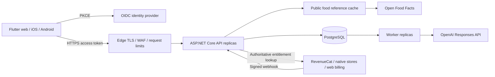

# Architecture and growth path

## Initial deployment

Start with one API, one worker, and one PostgreSQL service in the same Railway region. Deploy the same image with `Service__Role=api` or `worker`. `all` supports small single-service installations, but makes worker capacity follow API scaling. PostgreSQL is the source of truth; neither local memory nor a cache is required for correctness.

Railway PostgreSQL is a deployed database service: backups, restoration, failover and capacity planning must be explicitly configured. A single database service is not automatically a highly available database architecture.

## Components

| Directory | Responsibility |
|---|---|
| `Domain` | Entities and deterministic nutrition calculations |
| `Api` | Versioned endpoints, request validation, owner scoping and optimistic concurrency |
| `Infrastructure/AppDb.cs` | EF model, constraints and indexes |
| `Infrastructure/Quota.cs` | Atomic distributed counter reservation |
| `Infrastructure/AnalysisWorker.cs` | Durable queue, leases, retry and retention |
| `Infrastructure/OpenAiVision.cs` | Bounded OpenAI transport and structured output validation |
| `Infrastructure/Billing.cs` | Signature checking, event deduplication and authoritative subscription lookup |
| `Infrastructure/FoodCatalog.cs` | Public reference-data adapter and bounded cache |
| `Migrations` | Reviewable, versioned PostgreSQL schema changes |

Keep domain rules out of Flutter. Keep provider transport behind interfaces. Introduce separate assemblies when multiple teams need compile-time boundaries; separate network services only when independent ownership or scaling justifies their operational cost.

## Data flow

**Diary:** the client supplies a UUID and record version. The API derives the account from a validated token, validates quantities and dates, resolves only accessible food IDs, computes portions from reference nutrients, and stores the nutrient snapshot. Updates compare the version; stale clients receive 409. Historical totals do not change when the food catalog changes.

**Photos:** explicit consent → validate MIME/signature and size → lock account → check idempotency → verify unexpired premium entitlement → reserve user-month and global-day quotas → encrypt photo with AES-256-GCM, bound to owner → persist queued job → commit → return 202. The worker atomically claims a job using `FOR UPDATE SKIP LOCKED`, calls OpenAI with `store=false`, validates the result and writes it only if the lease token still matches. The encrypted photo is erased on completion or terminal failure. A 2-minute lease exceeds the 80-second processing timeout. No transaction is held during AI processing.

AI results are estimates, never medical measurements. The client presents food, grams, macros, uncertainty and follow-up questions. A user-reviewed result is saved separately as a `photo_confirmed` meal. Photo ingestion does not accept remote URLs, removing a common SSRF path. Signature checks are not full image decoding; the provider performs final decoding. Resize/strip EXIF in the Flutter client before upload; this backend never publicly serves uploaded images.

Jobs are at-least-once. A crash after an upstream success can repeat a paid call; fencing prevents stale writes, not duplicate upstream charges. Each job has at most three attempts. Quota counts accepted unique jobs, including failures. Retrying an existing idempotency key does not charge again, but a new key does. Global job caps are not a guaranteed currency-denominated spending cap; set provider spending controls too.

**Billing:** verify HMAC over raw bytes and a 5-minute delivery timestamp → deduplicate event ID transactionally → lock affected accounts in deterministic order → fetch current provider entitlements → upsert → commit. Never trust client premium flags or infer access from a cancellation event alone. Transfers reconcile both source and destination. Reordered events reconcile current state, so older event payloads cannot restore an obsolete expiry. Provider errors roll back and trigger webhook retries. Monthly/yearly subscriptions are supported; lifetime products are deliberately rejected. Grace periods use the provider's returned grace expiry.

## Database schema

| Table | Main columns | Important indexes / constraints |
|---|---|---|
| Accounts | UUID, OIDC subject, adult profile, goals, consent, version | Unique subject; version concurrency token |
| Foods | UUID, nullable owner, name, barcode, per-100g nutrients, source | Owner/name; barcode; GIN trigram name; nutrient bounds |
| Meals | UUID, owner, local calendar date, slot, name, source, version | Owner/date/ID; concurrency token |
| MealItem | UUID, meal FK, grams, nutrient snapshot | Cascade on meal delete; nonnegative nutrients |
| Weights | UUID, owner, date, kg | Unique owner/date; range constraint |
| Water | UUID, owner, date, millilitres | Owner/date; range constraint |
| Recipes | UUID, owner, name, servings, JSONB item snapshot, version | Owner FK; concurrency token |
| PlannedMeals | UUID, owner, date, slot, JSONB snapshot, version | Owner/date; concurrency token |
| Entitlements | UUID, owner, entitlement key, expiry, last event timestamp | Unique owner/product |
| BillingEvents | Provider event ID, received timestamp | Unique ID; no raw billing payload retained |
| AnalysisJobs | UUID, owner, idempotency key, request hash, encrypted photo, status, result JSONB, attempts, lease | Unique owner/key; status/available time; created time |
| UsageBuckets | Counter key, count, expiry | Primary key; expiry index |

Private records reference accounts with cascading deletion. Account IDs are internal UUIDs, not emails. All quantities use fixed-point decimals. Diary dates are explicitly user-selected calendar dates; operational timestamps and quota boundaries are UTC. Passwords and payment-card information are never stored here.

## Caching

- Public barcode reference cache: at most 2,000 entries per process; absolute TTL six hours. No sliding expiry. Provider outages return 503 rather than invented nutrition.
- OIDC signing keys use the framework's metadata cache and key rollover support.
- Private API responses use `Cache-Control: no-store`.
- Entitlements and quotas are read/written in PostgreSQL, avoiding stale permission grants and replica-local limits.
- All authenticated requests have an atomic per-account 120/minute PostgreSQL limit, plus a cheap per-process limiter for early rejection. The edge must provide anonymous request/body protection. Database quotas reserve within the same transaction as job creation.

When provider traffic warrants it, replace the public cache with Redis and coalesce concurrent misses with a short distributed lock. Cache immutable catalog versions and computed summaries keyed by account + diary revision; invalidate on mutations. Never cache an authorization decision beyond its verified validity.

## Growth triggers and tradeoffs

1. Scale API replicas on latency/CPU and workers on oldest queued-job age. Each worker processes one photo at a time; multiple replicas claim different jobs. Cap aggregate concurrency to the AI provider quota. Each replica has a bounded database pool.
2. Move temporary photo bytes into private S3-compatible object storage at sustained photo volume. Keep owner binding, lifecycle deletion and job IDs; do not put images or large messages in Redis. The initial encrypted `bytea` implementation is durable and simple but increases database/WAL/backup size.
3. Use a local, licensed food dataset for broad food-name search. The initial database starts empty; Open Food Facts provides packaged-food barcode lookup, not a full generic-food database. Preserve attribution and review database licensing before combining datasets.
4. Introduce Redis rate limits when counter-write volume materially burdens PostgreSQL. Keep scan quota/job reservations transactional or design a documented reservation/outbox protocol.
5. Move billing reconciliation to an inbox/worker before webhook throughput or provider latency becomes substantial. The initial implementation holds bounded account locks during provider lookups; it prioritizes transactional correctness at startup traffic. Alert on failed webhook retries and reconcile before commercial launch.
6. Add read replicas for analytics after measuring contention. Keep ownership, subscription and quota decisions on the primary. Consider partitioning large diary/job tables only when retention/maintenance or query measurements justify it.
7. Add a managed HA database and tested disaster recovery before requiring a stringent uptime target. Suggested initial operating targets: API p95 <300ms excluding providers/exports; 99.9% monthly availability; queued photos p95 <30s under normal provider conditions. These are design targets, not measured guarantees.

## Sources used

- [Microsoft JWT bearer authentication](https://learn.microsoft.com/en-us/aspnet/core/security/authentication/configure-jwt-bearer-authentication)
- [OpenAI image inputs and limitations](https://developers.openai.com/api/docs/guides/images-vision)
- [OpenAI structured outputs](https://developers.openai.com/api/docs/guides/structured-outputs)
- [RevenueCat webhook signatures and retries](https://www.revenuecat.com/docs/integrations/webhooks)
- [Open Food Facts API and usage requirements](https://openfoodfacts.github.io/documentation/docs/Product-Opener/api/)
- [Railway ASP.NET Core deployment](https://railway.com/guides/aspnet-core)
